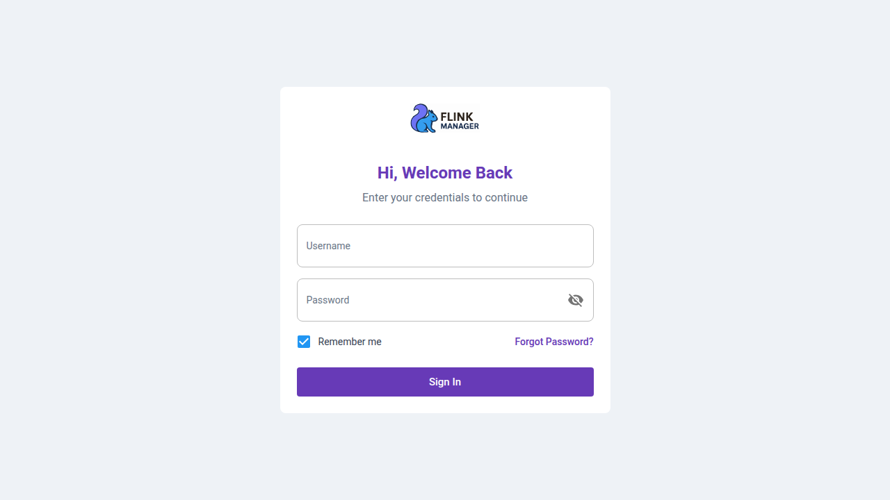
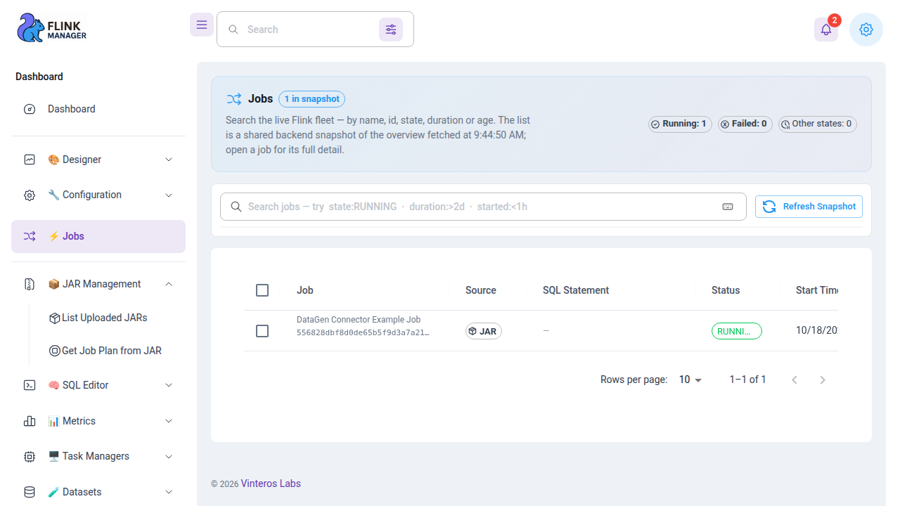
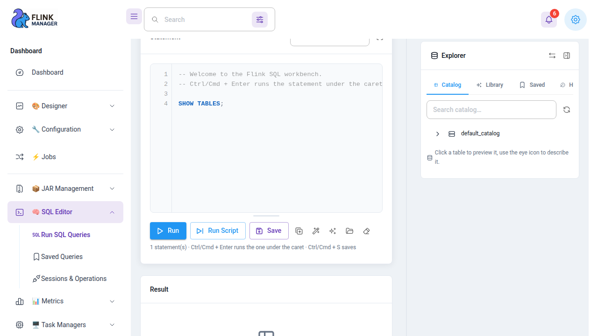
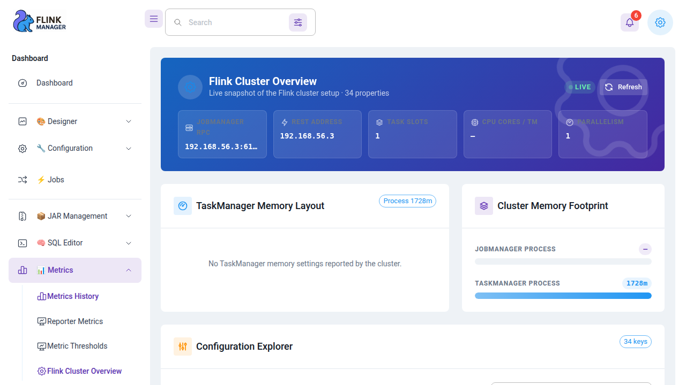
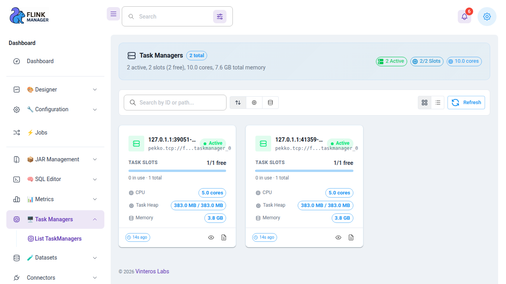
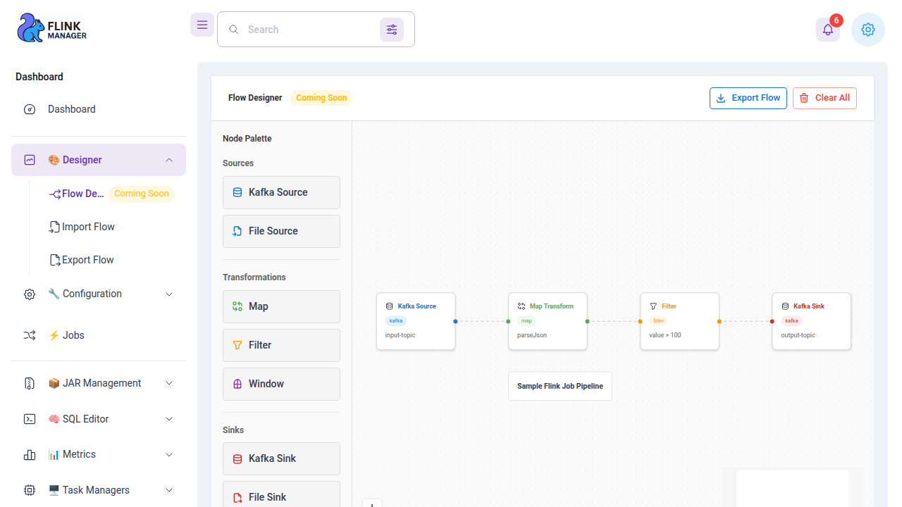

# Flink Manager

 

**Flink Manager** is a web console for operating an [Apache Flink](https://flink.apache.org/) cluster.
It proxies and enriches the Flink REST API, adds persistence (notifications), and ships an
integrated admin UI. It is a **commercial product** developed and sold by
**[Vinteros Labs](https://vinteros-labs.com/)**.

> ⚠️ **Licensed software.** Flink Manager is **not open source / not free**. You need a paid
> commercial licence to run it. **You can obtain a licence by visiting the company's website:
> [vinteros-labs.com](https://vinteros-labs.com/).** Trying it out is easy — a **free trial
> licence** is available directly at
> [vinteros-labs.com/products/flink-manager/license/](https://vinteros-labs.com/products/flink-manager/license/):
> the website issues a testing licence instantly, and Vinteros Labs keeps it renewed
> automatically. See [LICENSE-INFO.md](LICENSE-INFO.md) for full details. This repository
> contains installation and operation **documentation only**.

---

## What you get

| Area | What it does |
|---|---|
| **Cluster & jobs** | Flink cluster overview, job run/stop/restart with savepoints, TaskManagers & logs |
| **SQL** | SQL workbench via the Flink SQL Gateway, saved queries, session & operation history |
| **JARs** | Upload, list and inspect job JARs, preview the job plan before running |
| **Metrics & alerting** | Metrics history, metric thresholds, schedulers & reporters |
| **Flows** | Visual flow designer with import/export |
| **Governance** | Users & roles (RBAC), authentication providers (local, LDAP, OIDC), audit events |
| **Notifications** | Persistent notifications for job and system events |

## Screenshots

A quick look at the console — the full tour is in [05 — Screenshots](docs/05-screenshots.md).

| | |
|---|---|
|  |  |
|  |  |
|  |  |

*Login · Jobs · SQL workbench · Cluster metrics · TaskManagers · Flow Designer*

## Download

| Channel | Artifact |
|---|---|
| Release bundle | [flink-manager-0.0.1.zip](https://github.com/vinteroslabs/flink-manager-doc/releases/download/v0.0.1/flink-manager-0.0.1.zip) — application jar + start scripts + systemd unit |
| Docker image | [`vinteroslabs/flink-manager:0.0.1`](https://hub.docker.com/repository/docker/vinteroslabs/flink-manager) on Docker Hub |

## Documentation

| Guide | Purpose |
|---|---|
| [01 — Getting started](docs/01-getting-started.md) | Requirements + quick start |
| [02 — Installation](docs/02-installation.md) | Install for production use (bundle or Docker) |
| [03 — Configuration](docs/03-configuration.md) | Environment variables & settings reference |
| [04 — Licensing](docs/04-licensing.md) | How commercial licensing works |
| [05 — Screenshots](docs/05-screenshots.md) | What the console looks like |
| [06 — Releases](docs/06-releases.md) | Released versions & changelog |

## Quick links

| Item | Link |
|---|---|
| Get a licence (incl. free trial) | [vinteros-labs.com/products/flink-manager/license/](https://vinteros-labs.com/products/flink-manager/license/) |
| Online documentation | [vinteros-labs.com/resources/docs/](https://vinteros-labs.com/resources/docs/) |
| Changelog | [vinteros-labs.com/resources/changelog/](https://vinteros-labs.com/resources/changelog/) |
| Blog | [vinteros-labs.com/resources/blog/](https://vinteros-labs.com/resources/blog/) |
| Report an issue | [GitHub issue](https://github.com/vinteroslabs/flink-manager-doc/issues) or a ticket on [vinteros-labs.com](https://vinteros-labs.com/) |
| Company | [Vinteros Labs](https://vinteros-labs.com/) — Luxembourg |

## Prerequisites

- **Docker** to run the container image, **or Java 22+** (JDK) to run the release bundle directly
- A **PostgreSQL** database (the schema is created and migrated automatically on first start)
- A running **Apache Flink 2.x cluster** (SQL Gateway optional)
